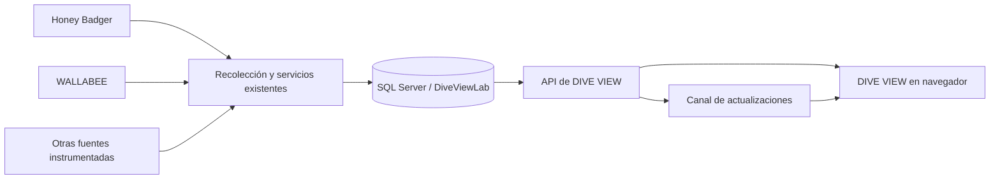

# DIVE VIEW Web — guía de diseño y migración

Guía visual y arquitectura objetivo. La primera implementación web está en `src/dive_view/web`; consulta README.md para su alcance actual. Las secciones de auditoría de operadores y recuperación por cursor describen evolución futura.

## Dirección visual

**Consola de observabilidad con estética tecnológica minimalista y tema oscuro.**

La interfaz transmite precisión, calma y control. El contenido principal son los eventos, las relaciones y las métricas del laboratorio. El carácter tecnológico proviene de la retícula, la tipografía monoespaciada en datos, los estados visibles y las gráficas; los efectos decorativos son discretos.

DIVE VIEW comparte el lenguaje de WALLABEE, pero presenta el conjunto del laboratorio: Honey Badger, WALLABEE y las demás fuentes que se integren. Su identidad es la de un centro de observación y consulta.

Referencia implementada: `src/Wallabee.API/wwwroot/index.html`, `dashboard.css` y `dashboard.js`. Tokens portables: [design-tokens.css](../src/dive_view/web/static/design-tokens.css).

## Sistema visual

| Elemento | Especificación |
|---|---|
| Fondo | Carbón `#0c1013` |
| Superficie de panel | `#111619`; superficie secundaria `#151c20` |
| Separadores | Borde de 1 px `#252d31` |
| Texto principal | Blanco suave `#e9efed` |
| Texto secundario | Gris `#839097` |
| Acento de marca | Lima `#b8f476`, para acción principal y selección |
| Estados | Verde `#88d9af`, azul `#8cafee`, amarillo `#dec477`, naranja `#e6a273`, rojo `#ed7f83` |
| Tipografía de lectura | Inter si está disponible localmente; Segoe UI y sans-serif como alternativas |
| Datos técnicos | Consolas, SFMono-Regular, monospace; cifras tabulares |
| Escala tipográfica | Texto habitual 14 px; tablas 13–14 px; etiquetas 11–12 px; títulos de página 28–34 px |
| Espaciado | Escala de 4, 8, 12, 16, 24, 32 y 48 px |
| Geometría | Radios contenidos de 4–8 px; retícula alineada; bordes finos |
| Movimiento | Transiciones breves de 120–180 ms; respetar reducción de movimiento |

Usar el lima con moderación. Reservar rojo y naranja para estados que requieren atención. Combinar siempre color con texto o icono. Validar contraste de texto, foco y controles en la implementación; el gris de una línea decorativa no se reutiliza automáticamente para texto.

Mantener fondos planos, sombras suaves únicamente donde aporten jerarquía y gráficas sin volumen. Evitar grandes resplandores, fondos animados, tarjetas excesivamente redondeadas y decoraciones que compitan con los datos.

## Composición y navegación

En escritorio, barra lateral de aproximadamente 224 px, barra superior de 64 px y contenido organizado en una retícula de doce columnas. La barra superior conserva entorno, rango temporal, estado de conexión y usuario. El contenido dispone de suficiente ancho para investigar eventos.

En tablet, navegación compacta. En móvil, menú desplegable y paneles apilados. Las tablas conservan desplazamiento horizontal cuando sea necesario; el detalle pasa de panel lateral a vista completa. Ninguna acción depende de hover.

| Vista propuesta | Contenido principal |
|---|---|
| Resumen | Eventos recibidos, ejecuciones activas, fuentes conectadas, alertas y actividad temporal |
| Eventos | Explorador unificado, filtros combinables, búsqueda, orden y paginación |
| Experimentos | Experimento → ronda → ejecución → muestra → resultado e indicadores |
| Sistemas | Fuentes/hosts registrados, versión, última señal y estado reportado |
| Métricas | Latencia, volumen, recursos y comparación de periodos, versiones y resultados |
| Auditoría | Acciones registradas de operadores: cambios, comandos y exportaciones |

Estas vistas y rutas son propuestas; su disponibilidad depende del inventario del proyecto actual y de las fuentes que realmente publiquen esos datos.

## Componentes e interacción

- **Tarjeta de indicador:** etiqueta, valor, unidad, periodo y contexto. Mostrar comparación solo cuando exista un periodo comparable.
- **Gráfica:** título preciso, unidades, rango temporal, leyenda, tooltip y alternativa tabular o resumen accesible. Series consistentes entre pantallas.
- **Explorador de eventos:** fecha, origen, tipo, severidad, estado, experimento/ronda y correlación. Filtros sincronizados con la URL para compartir una investigación.
- **Detalle lateral:** resumen, cronología, relaciones y payload estructurado con campos sensibles excluidos o redactados. Permitir copiar identificadores y abrir eventos relacionados.
- **Estado de conexión:** Conectando, En vivo, Reconectando, Pausado o Sin conexión, junto con la hora de la última actualización recibida.
- **Estados vacíos:** distinguir carga inicial, ausencia de eventos, filtros sin coincidencias, datos parciales y error de una fuente.

La llegada de eventos no debe desplazar una fila mientras se está leyendo. Mostrar un contador de eventos nuevos y permitir incorporarlos. Pausar la vista conserva la recolección del servidor. Mantener filtros, selección y foco durante las actualizaciones.

## Gráficas del centro de observación

1. Volumen de eventos a lo largo del tiempo, agrupado por origen.
2. Duración de ejecuciones y percentiles P50/P95/P99 con población y periodo explícitos.
3. Distribución de severidad y tipos de eventos.
4. CPU y memoria por host o proceso, identificando qué se está midiendo.
5. Comparación de experimentos y versiones, con métricas de detección y evasión únicamente cuando existan etiquetas de referencia.

Las distribuciones pequeñas pueden usar dona; las comparaciones entre categorías se muestran mejor con barras. Usar líneas para evolución temporal. Un dato faltante se representa como no disponible o hueco en la serie, nunca como cero. Diferenciar una fuente desconectada de una fuente que reporta cero actividad.

## De escritorio a aplicación web

Separar la recolección, persistencia y ejecución de tareas de la presentación. El navegador consulta datos y envía acciones a una API; los servicios del laboratorio siguen recolectando aunque nadie tenga abierta la página.

El diagrama expresa responsabilidades. WALLABEE ya escribe directamente en DiveViewLab mediante EF Core; esa ruta puede conservarse. No hace falta activar su exportación HTTP opcional para consultar los resultados existentes. Si se elige además recibir eventos por HTTP, definir deduplicación por identificador y evitar contabilizar dos veces el mismo evento.

La UI web accede a SQL mediante la API, sin conexiones SQL ni credenciales de base de datos en el navegador. Las funciones que requieren archivos, procesos o recursos locales permanecen en servicios/agentes del laboratorio. Una ruta del servidor no representa un archivo del equipo que abre la web.

Para el primer paso, conservar el backend y contratos aprovechables del proyecto de escritorio, extraer dependencias de ventanas y controles, e incorporar un host web. Seleccionar el framework de interfaz al revisar el proyecto; esta guía y sus tokens son independientes del framework.

Publicar como aplicación web accesible por una URL requiere alojamiento del backend, conectividad con la base, HTTPS y acceso de usuarios. La primera entrega puede operar en localhost o en la red privada. La publicación en Internet se prepara según el entorno elegido; una vista web no exige hacer públicos los eventos.

## Qué significa recolectar todas las interacciones

Definir un catálogo verificable de interacciones: inicio/progreso/fin de ejecución, resultados, indicadores, errores, eventos de sistemas y acciones relevantes de operadores. Cada productor debe instrumentar los tipos acordados. La UI no puede reconstruir interacciones que nunca se registraron.

El registro propuesto contiene identificador estable, tipo y versión de esquema, fecha del evento y de recepción, origen/host, estado/severidad, correlación, referencias a experimento/ronda/ejecución y metadata permitida. El actor se incluye cuando corresponda. Conservar la precisión de fechas y permitir eventos tardíos.

En la recolección, contemplar almacenamiento durable, reintentos y deduplicación. En consultas, usar paginación, filtros de servidor y agregación temporal. En el canal en vivo, recuperar eventos desde un cursor tras reconectar. No descargar todo el historial al navegador ni usar el búfer en memoria de WALLABEE como historial global: hoy ese búfer es transitorio y por instancia.

Separar eventos de dominio de actividad visual del usuario. Las acciones auditables deben producir registros explícitos; capturar cada movimiento del ratón no aporta por sí mismo trazabilidad del laboratorio. Credenciales, secretos y contenido binario de muestras quedan fuera del payload de observación.

## Secuencia de implementación

1. Inventariar pantallas, tareas en segundo plano, fuentes de eventos y dependencias locales del escritorio.
2. Confirmar qué eventos ya persisten en DiveViewLab y qué instrumentación falta.
3. Extraer o reutilizar servicios y exponer consultas paginadas mediante API.
4. Implementar la estructura web con estos tokens y el explorador de eventos sobre datos reales.
5. Incorporar actualizaciones en vivo, detalle, filtros persistentes y gráficas agregadas.
6. Validar trazabilidad, concurrencia, reconexión, acceso por usuario y comportamiento responsive.
7. Preparar alojamiento y comparar funciones con el escritorio antes de sustituirlo.

## Criterios de aceptación

- La recolección continúa con el navegador cerrado.
- Eventos relacionados pueden seguirse de extremo a extremo mediante correlación.
- Reconectar recupera eventos sin duplicarlos ni ocultar intervalos faltantes.
- Cada gráfica explicita periodo, unidades y origen; los números provienen de consultas reales.
- Buscar, paginar o filtrar no requiere descargar el historial completo.
- Foco, teclado, contraste y reducción de movimiento se verifican en las pantallas implementadas.
- La vista funciona en escritorio, tablet y móvil y conserva la identidad de WALLABEE.
- La migración conserva los datos y las funciones acordadas del escritorio.

## Instrucción reutilizable para el proyecto DIVE VIEW

> Migra la presentación de DIVE VIEW de escritorio a una aplicación web de observabilidad, conservando su recolección y persistencia en servicios independientes del navegador. Revisa primero el proyecto y reutiliza su lógica y contratos. Aplica el sistema visual de WALLABEE: fondo carbón #0c1013, paneles #111619, bordes #252d31, texto #e9efed y acento lima #b8f476; tipografía sans-serif para lectura y monoespaciada para datos, radios de 4–8 px y composición sobria. Incluye resumen, explorador de eventos, experimentos, sistemas, métricas y auditoría según los datos disponibles. Implementa búsqueda y paginación de servidor, correlación, detalle lateral y actualizaciones en vivo que preserven la lectura. Usa datos reales y muestra explícitamente carga, ausencia de datos, desconexión y reconexión. Asegura que cerrar la web no detenga la recolección y valida las funciones antes de sustituir el escritorio. Sigue esta guía y los tokens adjuntos; documenta cualquier fuente que todavía no publique los eventos requeridos.
