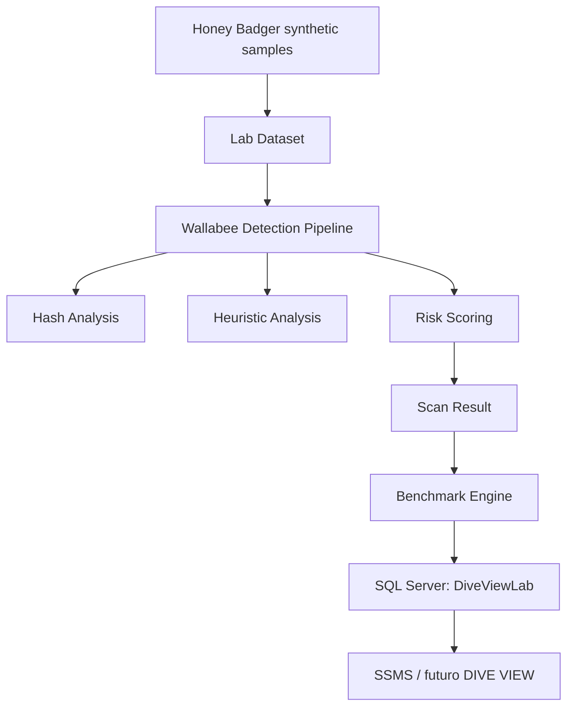

# Honey Badger vs Wallabee

Laboratorio educativo y aislado para experimentar con deteccion de archivos. Wallabee es un detector experimental modular; Honey Badger queda reservado para generar muestras sinteticas e inertes dentro de `lab` en una fase posterior.

## Arquitectura

- `Wallabee.Core`: contratos, modelos y reglas puras de deteccion.
- `Wallabee.Application`: casos de uso y pipeline de orquestacion.
- `Wallabee.Infrastructure`: SHA-256, analisis estatico, EF Core SQL Server transaccional y cuarentena local durable.
- `Wallabee.Benchmark`: rendimiento real, metricas con etiquetas y resultados persistentes.
- `Wallabee.Contracts`: DTOs HTTP y de telemetria.
- `Wallabee.Telemetry`: cola local, publicacion HTTP con ACK y reintentos.
- `Wallabee.API`: API HTTP delgada con controllers y OpenAPI.



## Uso

```powershell
dotnet tool restore
dotnet restore HoneyBadgerVsWallabee.sln
dotnet ef database update --project src/Wallabee.Infrastructure --startup-project src/Wallabee.API --configuration Release
dotnet build HoneyBadgerVsWallabee.sln -c Release
dotnet test HoneyBadgerVsWallabee.sln -c Release
dotnet run --project src/Wallabee.API -c Release
```

La API expone `GET /api/health`, los endpoints de escaneo bajo `/api/scan`, benchmark bajo `/api/benchmark` y cuarentena bajo `/api/quarantine`.

## Interfaz en vivo

La API sirve el dashboard WALLABEE desde `/`: actividad de escaneos y benchmarks, gráficas de latencia/riesgo/CPU, resultados, filtros y exportación CSV. Consulta [uso y alcance del dashboard](docs/DASHBOARD.md).

## Ejecutable para usuarios de Windows

Descarga **Wallabee-win-x64.zip** desde [GitHub Releases](https://github.com/ALVAROARUIZ/Cyber-Secury-Tests/releases/latest). En las nuevas releases, al descomprimir encontrarás únicamente **Wallabee.exe**, con su icono. Al abrirlo inicia la API y abre automáticamente el panel web, sin consola ni instalación de .NET. Usa su icono de la bandeja de Windows para salir.

Los componentes internos se guardan en `%LOCALAPPDATA%\Wallabee`. SQL Server sigue siendo necesario para persistir resultados. Consulta [instalación, conexión y actualizaciones](docs/VM_WINDOWS.md). El código fuente y el paquete interno de actualización son para desarrollo y mantenimiento; la descarga de usuario es `Wallabee-win-x64.zip`.

## Reglas del laboratorio

- Las muestras deben ser sinteticas, benignas e inertes.
- Las rutas de escaneo, cuarentena, restauracion y futuras muestras se canonicalizan con `Path.GetFullPath()` y deben permanecer dentro de `LabRoot`.
- SQL Server conserva unicamente metadata y resultados; las muestras permanecen fuera de las bases de datos.


## Flujo durable y DIVE VIEW

Cada scan confirma metadata, indicadores y evento en una transacción de SQL Server. DiveViewLab es la fuente central para SSMS y el futuro DIVE VIEW. La exportación HTTP con ACK se conserva como opción, desactivada por defecto. AutoQuarantine y RetainSample siguen en false. No se guardan archivos ni raw bytes en la base.

La solucion modular es `HoneyBadgerVsWallabee.sln` (tambien `Wallabee.slnx`). Ejecutar `src/Wallabee.API`; el scaffold web de la raiz no es el host del laboratorio. SQL Server usa `DiveViewLab` mediante `ConnectionStrings:DiveViewDatabase`; la cuarentena fisica en `data/quarantine`. Las muestras siguen en `lab`. El SDK requerido es .NET 10.

Documentacion:

- [Arquitectura, dependencias y esquema SQL Server](docs/ARCHITECTURE.md)
- [Cola, ACK y retries](docs/TELEMETRY.md)
- [Benchmarks, etiquetas y percentiles](docs/BENCHMARKING.md)
- [Requests y responses de Honey Badger](docs/HONEY_BADGER_INTEGRATION.md)
- [Contrato de integracion DIVE VIEW](docs/DIVE_VIEW_INTEGRATION.md)
- [SQL Server, SSMS, conexión y migrations](docs/DATABASE.md)
- [Informe de migración y validación](docs/SQLSERVER_MIGRATION_REPORT.md)

`GET /api/scans/experiment/{experimentId}/round/{roundId}` consulta resultados correlacionados. `GET /api/telemetry/status` muestra Pending/Failed/Published y `POST /api/telemetry/retry` reactiva fallos. Sin etiquetas de referencia, las tasas de deteccion no se inventan: se informan como no disponibles.

SQL Server Express/Developer es requerido; configuración local revisada: `.\SQLEXPRESS`, autenticación Windows, base `DiveViewLab`. Development aplica migrations y verifica conexión; Production requiere aplicarlas durante despliegue. GET /api/health incluye SQL Server y persistencia.
