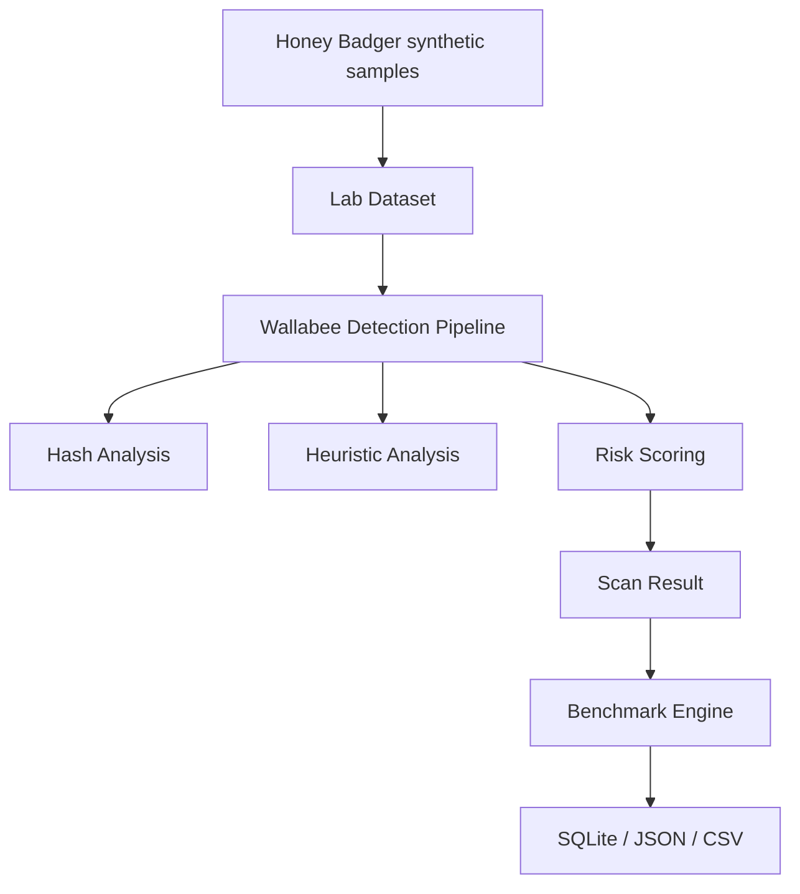

# Honey Badger vs Wallabee

Laboratorio educativo y aislado para experimentar con deteccion de archivos. Wallabee es un detector experimental modular; Honey Badger queda reservado para generar muestras sinteticas e inertes dentro de `lab` en una fase posterior.

## Arquitectura

- `Wallabee.Core`: contratos, modelos y reglas puras de deteccion.
- `Wallabee.Application`: casos de uso y pipeline de orquestacion.
- `Wallabee.Infrastructure`: SHA-256, acceso local al sistema de archivos y cuarentena.
- `Wallabee.Benchmark`: calculo y almacenamiento temporal de metricas.
- `Wallabee.API`: API HTTP delgada con controllers y OpenAPI.



## Uso

```powershell
dotnet build HoneyBadgerVsWallabee.sln
dotnet test HoneyBadgerVsWallabee.sln
dotnet run --project src/Wallabee.API
```

La API expone `GET /api/health`, los endpoints de escaneo bajo `/api/scan`, benchmark bajo `/api/benchmark` y cuarentena bajo `/api/quarantine`.

## Ejecutable y actualizaciones para Windows

Descarga `Wallabee-win-x64.zip` de [GitHub Releases](https://github.com/ALVAROARUIZ/Cyber-Secury-Tests/releases/latest).
Extrae el paquete y ejecuta `Wallabee.exe`. Incluye .NET y busca actualizaciones
cada cinco minutos. Cada push a `main` genera una release tras superar las pruebas.
Consulta [la guia de instalacion en una VM](docs/VM_WINDOWS.md), incluido el token
de lectura necesario para descargar actualizaciones del repositorio privado.

## Reglas del laboratorio

- Las muestras deben ser sinteticas, benignas e inertes.
- Las rutas de escaneo, cuarentena, restauracion y futuras muestras se canonicalizan con `Path.GetFullPath()` y deben permanecer dentro de `LabRoot`.
- No se implementa persistencia, propagacion, robo de datos ni cambios sensibles del sistema.
