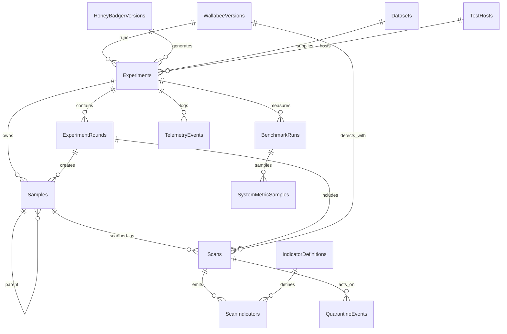
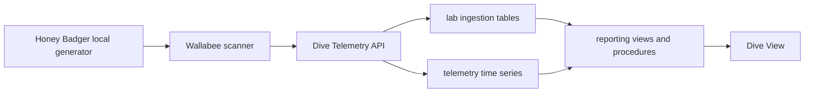

# DiveViewLab Database Architecture

## Purpose

`DiveViewLab` is the SQL Server analytical store for the Honey Badger vs Wallabee laboratory and the Dive View UI. It stores metadata, hashes, results, telemetry, metrics and external storage references. It never stores sample bytes, generated files, padding, `VARBINARY(MAX)`, or other binary content.

## Proposed Logical Model

The normalized ingestion model is `Experiment -> Round -> Sample -> Scan -> ScanIndicator`. Versions, hosts, datasets and indicator definitions are reference data. `benchmark` holds durable aggregates and `telemetry` holds time-series ingestion. `reporting` is the only schema Dive View should query.

## Tables And Relationships

- `lab`: versions, hosts, datasets, experiments, rounds, sample metadata, scans, indicator definitions, indicator observations, quarantine actions and experiment events.
- `benchmark`: `BenchmarkRuns` holds query-friendly aggregates; `DetectionConfusionMatrix` preserves explicitly computed classification totals.
- `telemetry`: `SystemMetricSamples` is high-volume temporal telemetry; `TelemetryEvents` is a correlated event stream.
- `reporting`: eight views and seven stored procedures form the Dive View read contract.

No foreign key uses `ON DELETE CASCADE`. Experiments are archived via `IsArchived` and `ArchivedAt`; physical deletion is intentionally absent from the normal workflow.

`Samples.GroundTruthLabel` is the one purposeful addition to the supplied field list. `SampleType` alone is not a stable ground-truth signal, so a normalized label of `Benign`, `Malicious`, or `Unknown` is required to calculate false positives and false negatives correctly.

## Normalization And Aggregates

Version strings, host characteristics and indicator descriptions are stored once and referenced by keys. Hashes are duplicated on `Samples`, `Scans`, and quarantine events only as immutable facts necessary for independent ingest/audit correlation. Round and benchmark metrics are deliberate aggregates used by dashboards; detailed scans and metric samples remain available for drill-down.

## Index Strategy

High-selectivity lookup paths include hash searches, scan sample lookups, experiment/round drill-down, and version/time trends. Composite indexes support `Scans(ExperimentId, RoundId)`, `Scans(WallabeeVersionId, StartedAt)`, telemetry `(BenchmarkId, TimestampUtc)`, telemetry `(ExperimentId, RoundId, TimestampUtc)`, and event timelines. The retained-sample filtered index keeps archival research efficient without indexing all samples twice.

## Ingestion Flow

Writers should insert reference data first, then experiment, round/sample/scan rows, followed by indicators and events. The API should validate that a round and sample belong to the supplied experiment because that cross-row business rule cannot be fully expressed by independent foreign keys.

## Dive View Contract

Use `reporting.vw_ExperimentOverview`, `vw_RoundPerformance`, `vw_VersionComparison`, `vw_IndicatorFrequency`, and `vw_LatencyTrend` for grids and charts. Use `reporting.usp_GetExperimentDashboard`, `usp_GetRoundDetails`, and the false-positive/false-negative procedures for drill-down. `DiveViewReader` has access only to this schema and its procedures.

## Retention And Growth

- Keep raw `telemetry.SystemMetricSamples` for 30-90 days, subject to laboratory needs.
- Keep benchmark aggregates, scans/results, retained sample metadata, and version history indefinitely or under a configurable archival policy.
- Do not automate deletion in v1. Archive experiments first and export telemetry only through an approved operational process.
- For future scale, partition `lab.Scans` by `StartedAt`, `telemetry.SystemMetricSamples` by `TimestampUtc`, and `telemetry.TelemetryEvents` by `TimestampUtc`. Align the existing time-leading query indexes with the partition key and use a sliding-window retention process.

## Deployment

Run `00_CreateDatabase.sql` through `08_SeedData.sql` in numeric order with `sqlcmd`, then run `ValidateDatabase.sql`. `99_ResetDevelopmentDatabase.sql` is development-only and refuses to run without `ConfirmReset=YES`.