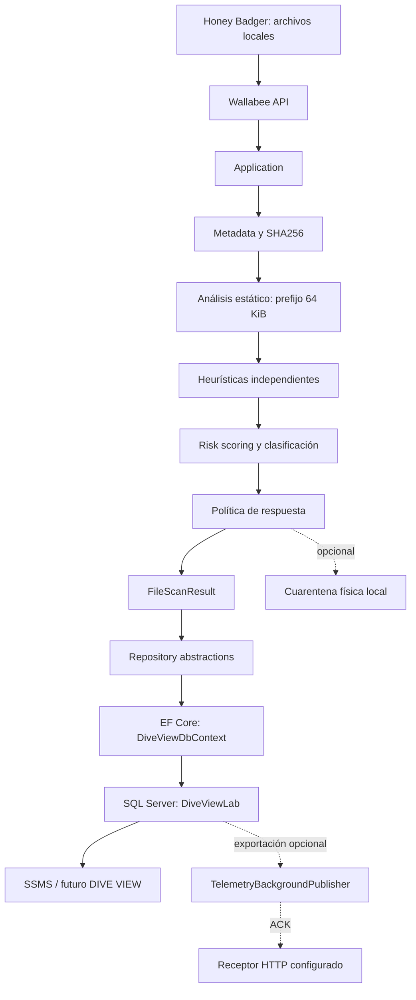

# Arquitectura WALLABEE con SQL Server

Se conserva la solución modular HoneyBadgerVsWallabee.sln / Wallabee.slnx y el Launcher existente. Core no depende de EF, SQL, HTTP ni ASP.NET. Los contratos públicos HTTP no exponen entidades EF.

| Proyecto | Referencias internas | Responsabilidad |
|---|---|---|
| Core | Ninguna | Modelos, puertos, reglas y política |
| Contracts | Ninguna | Requests y DTOs públicos |
| Application | Core, Contracts | Orquestación y mapping público |
| Infrastructure | Core, Application | Filesystem, hashing, EF SQL Server, cuarentena |
| Benchmark | Core, Application, Contracts | Medición, etiquetas y agregados |
| Telemetry | Core, Contracts | Publicación HTTP opcional y retries |
| API | Módulos anteriores | DI, arranque y controllers delgados |

ScanResult conserva el agregado original; FileScanResult representa cada archivo. EfScanResultRepository mapea a ScanEntity, SampleEntity y ThreatIndicatorEntity. Los indicadores no se serializan como documento gigante. La transacción incluye referencias, scan, indicadores y evento de metadata. El scanner/pipeline no escribe directamente a DB.

Cada repositorio usa IDbContextFactory: contexto nuevo por operación, nunca compartido entre scans paralelos. El DbContext también está disponible scoped para arranque/administración. Program delega composición a AddWallabeeInfrastructure/AddWallabeePersistence y la inicialización a DatabaseStartup.

Se conservan las reglas HighEntropy, ExtensionMismatch, UnusualFileSize, KnownHash, MetadataMismatch, RepeatedPatterns y SyntheticAnomaly. Scoring predeterminado: <20 Clean, <50 Low, <75 Medium, <90 High, >=90 Critical. AutoQuarantine=false; Critical produce Alert mientras no se habilite cuarentena. El hash cubre todo el archivo y el análisis estadístico un prefijo limitado.

La cuarentena sigue en data/quarantine; solo su metadata se persiste en lab.QuarantineEvents. Las rutas originales se validan dentro de LabRoot y las rutas de cuarentena dentro de su raíz propia. Restore no sobrescribe archivos y verifica SHA256. La operación filesystem y SQL no es distribuida; los estados Pending/Restoring documentan recuperaciones.

RetainSample es metadata de intención, no copia contenido. Los binarios y muestras no se envían a SQL Server. Para esquema, tipos, migraciones y restricciones de compatibilidad, consultar [DATABASE.md](DATABASE.md).
