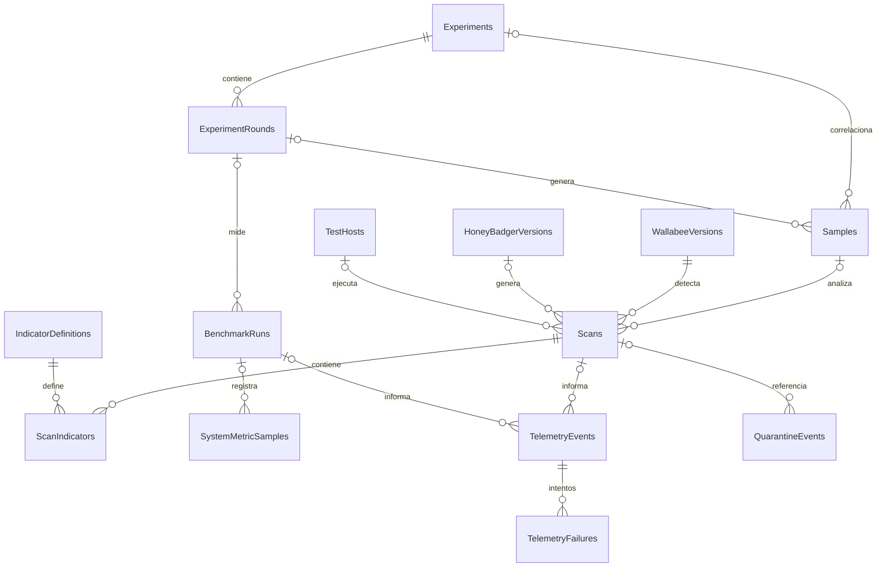

# Persistencia SQL Server: DiveViewLab

SQL Server es la fuente central de metadata de WALLABEE. El proveedor es EF Core SQL Server 10.0.12 sobre .NET 10. Las muestras, cuarentena física, padding y bytes permanecen en filesystem; no hay columnas VARBINARY para contenido de laboratorio.

## Requisitos y configuración

Instalar SQL Server Developer o Express y SQL Server Management Studio (SSMS). SSMS es un cliente de administración: no sustituye al servicio de SQL Server. En el entorno verificado está activa la instancia `.SQLEXPRESS`.

`src/Wallabee.API/appsettings.json` y `appsettings.Development.json` usan autenticación Windows:

```json
{
  "ConnectionStrings": {
    "DiveViewDatabase": "Server=.\SQLEXPRESS;Database=DiveViewLab;Trusted_Connection=True;TrustServerCertificate=True;"
  }
}
```

Para una instancia predeterminada:

```text
Server=localhost;Database=DiveViewLab;Trusted_Connection=True;TrustServerCertificate=True;
```

No se fija una conexión en código. Runtime y herramientas EF leen IConfiguration, configuración por entorno, user secrets y variables de entorno. TrustServerCertificate=True sirve para el laboratorio local; un servidor con certificado confiable permite Encrypt=True;TrustServerCertificate=False.

Credenciales SQL opcionales, sin versionarlas:

```powershell
dotnet user-secrets set "ConnectionStrings:DiveViewDatabase" "Server=localhost;Database=DiveViewLab;User ID=wallabee;Password=<contraseña-local>;Encrypt=True;TrustServerCertificate=True;" --project src/Wallabee.API
# Alternativa para el proceso/servicio:
$env:ConnectionStrings__DiveViewDatabase = '<connection string administrada como secreto>'
```

No copiar contraseñas reales a appsettings, documentación o argumentos registrados por CI. El usuario de migraciones necesita permisos de DDL; la cuenta de ejecución habitual puede tener únicamente los permisos necesarios para leer/escribir metadata. Para una DB nueva, la identidad que inicializa necesita CREATE DATABASE.

## Inicialización y EF

Desde la raíz del repositorio:

```powershell
dotnet tool restore
dotnet restore HoneyBadgerVsWallabee.sln
dotnet build HoneyBadgerVsWallabee.sln -c Release
dotnet ef migrations list --project src/Wallabee.Infrastructure --startup-project src/Wallabee.API --configuration Release
dotnet ef database update --project src/Wallabee.Infrastructure --startup-project src/Wallabee.API --configuration Release
dotnet run --project src/Wallabee.API -c Release
```

El manifiesto `dotnet-tools.json` fija dotnet-ef 10.0.12. Para crear un cambio futuro:

```powershell
dotnet ef migrations add NombreDelCambio --project src/Wallabee.Infrastructure --startup-project src/Wallabee.API --configuration Release --output-dir Persistence/Migrations
dotnet ef migrations has-pending-model-changes --project src/Wallabee.Infrastructure --startup-project src/Wallabee.API --configuration Release
```

Migraciones incorporadas:

1. `InitialSqlServerMigration`: crea una base nueva o adopta el esquema SQL existente revisado; añade metadata de aplicación y outbox.
2. `PreserveVersionContractLengths`: amplía Version a varchar(100), preservando el límite del contrato Honey Badger.
3. `AlignForeignKeyIndexes`: completa índices de FK esperados por el modelo EF, sin recrear índices que ya existen.

En Development, el host ejecuta MigrateAsync y comprueba conexión antes de escuchar. Los errores se registran y abortan el arranque. En Production, aplicar migrations como paso de despliegue; no se aplica DDL automáticamente. Las herramientas EF no ejecutan el inicializador del host en design time. No se usa EnsureCreated.

Para SSMS también se genera `database/09_EfMigrations.sql`, idempotente por historial EF. Abrirlo conectado a DiveViewLab y ejecutarlo con una cuenta de migraciones. Para una DB vacía, crearla primero o usar `dotnet ef database update`. No ejecutar nuevamente 02_CreateTables.sql sobre una base ya inicializada.

## Adopción del esquema existente

Ya existían los esquemas lab, benchmark, telemetry y reporting en DiveViewLab, con versiones e indicadores de referencia. Se reutilizan las tablas en vez de crear otro conjunto bajo dbo. La primera migration incorpora una copia inmutable de los scripts base en Infrastructure/Persistence/Migrations/Baseline, verifica las tablas y columnas esperadas y aplica cambios adicionales dentro de la transacción EF. No borra datos ni tablas.

Los scripts originales `database/00` a `08`, vistas y procedimientos se conservan. En instalaciones nuevas las migrations crean las tablas y constraints; si se necesitan las vistas/procedimientos/roles originales de reporting, aplicar 05_CreateViews.sql, 06_CreateProcedures.sql y 07_CreateRoles.sql una vez después de migrar. Las vistas existentes de la instancia verificada se conservaron.

La adopción está diseñada para el baseline revisado, no para esquemas arbitrarios con nombres parecidos. Una tabla/columna faltante aborta la migración. Antes de adoptar otra instalación, comparar esquema, realizar backup y revisar el SQL generado. IDs externos duplicados o payloads históricos superiores a 4000 caracteres requieren corrección/archivo deliberado; no se truncan automáticamente.

Los métodos Down de estas migraciones rechazan eliminaciones/reducciones automáticas: las tablas pueden contener datos anteriores a EF. Recuperar una copia verificada para rollback operacional.

El antiguo SQLite inspeccionado tenía cero scans, indicadores, benchmarks, cuarentenas y eventos; no hubo datos que importar. Sus archivos se conservan en disco y ya no se abren desde la aplicación. No existe un importador automático para otros SQLite con datos: exportar/validar metadata por separado antes de cambiar una instalación con historial.

## Entidades y nombres físicos en SSMS

| Entidad EF | Tabla reutilizada |
|---|---|
| ExperimentEntity | lab.Experiments |
| ExperimentRoundEntity | lab.ExperimentRounds |
| SampleEntity | lab.Samples |
| ScanEntity | lab.Scans |
| ThreatIndicatorEntity | lab.ScanIndicators |
| IndicatorDefinitionEntity | lab.IndicatorDefinitions |
| BenchmarkResultEntity | benchmark.BenchmarkRuns |
| SystemMetricEntity | telemetry.SystemMetricSamples |
| TelemetryEventEntity | telemetry.TelemetryEvents |
| TelemetryFailureEntity | telemetry.TelemetryFailures |
| WallabeeVersionEntity | lab.WallabeeVersions |
| HoneyBadgerVersionEntity | lab.HoneyBadgerVersions |
| TestHostEntity | lab.TestHosts |
| QuarantineEventEntity | lab.QuarantineEvents |

También se mapean Datasets, ExperimentEvents y DetectionConfusionMatrix existentes. Los nombres ScanIndicators, BenchmarkRuns y SystemMetricSamples se conservan para no romper las vistas/procedimientos anteriores. No hay tablas duplicadas ThreatIndicators/BenchmarkResults/SystemMetrics.



IDs internos son UNIQUEIDENTIFIER o claves de referencia INT/BIGINT existentes. Los IDs públicos EXP/Round/Sample siguen siendo strings y se conservan en External*Id; no se exige convertirlos a GUID. Rondas sin ExperimentId mantienen el string externo del scan, pero no crean una ronda sin padre. Escaneos sin experimento pueden tener metadata de Sample sin experiment FK. Un mismo SampleId dentro de experimento/ronda no puede cambiar de hash/tamaño.

SHA256 usa CHAR(64). DetectionLevel usa VARCHAR(30) mediante conversión EF. Fechas DATETIME2(3) en UTC; el mapper reconstruye DateTimeOffset UTC. DECIMAL tiene precisión explícita: riesgo/pesos (9,4), tasas (9,6), duraciones (18,6), throughput (18,4), memoria (18,3), CPU (7,3). No se guarda un JSON completo de scan o benchmark; los indicadores y métricas son relacionales.

## Concurrencia y transacciones

AddWallabeePersistence registra IDbContextFactory y el DbContext scoped proporcionado por EF. Los repositorios usan una instancia nueva por operación y por reintento. Esto permite escaneos paralelos y BackgroundService sin compartir un DbContext singleton.

EfUnitOfWork usa una transacción Serializable con la estrategia de reintentos SQL Server. Creación de referencias, Sample, Scan, indicadores y evento se confirma o revierte como unidad. Una clave ScanId/BenchmarkId ya confirmada evita duplicados al reintentar un commit ambiguo. Consultas read-only usan AsNoTracking y métodos async con CancellationToken.

BenchmarkDto se traduce a columnas de BenchmarkRuns; no se persiste el JSON recibido por el puerto de compatibilidad. El benchmark también actualiza el resumen de su ronda con la ejecución más reciente y guarda la matriz de confusión. ExpectedLabels actualiza GroundTruthLabel en Samples para las consultas de falsos positivos/negativos.

## SSMS: verificar la instalación

Conectar con autenticación Windows a `.\SQLEXPRESS` y abrir **Databases → DiveViewLab → Tables**. Refrescar el árbol después de migrar. Revisar los nombres físicos de la tabla anterior.

```sql
USE DiveViewLab;
SELECT * FROM dbo.__EFMigrationsHistory;
SELECT TOP (100) * FROM lab.Scans ORDER BY StartedAt DESC;
SELECT TOP (100) * FROM lab.ScanIndicators;
SELECT * FROM lab.Experiments;
SELECT * FROM lab.ExperimentRounds;
SELECT TOP (100) * FROM lab.Samples;
SELECT TOP (100) * FROM benchmark.BenchmarkRuns ORDER BY StartedAt DESC;
SELECT TOP (100) * FROM telemetry.SystemMetricSamples ORDER BY TimestampUtc DESC;
SELECT TOP (100) EventId, EventType, State, Attempts, ScanId, BenchmarkId FROM telemetry.TelemetryEvents;
SELECT name, is_disabled, is_not_trusted FROM sys.foreign_keys;
SELECT OBJECT_SCHEMA_NAME(object_id) AS [Schema], OBJECT_NAME(object_id) AS [Table], name FROM sys.indexes WHERE index_id > 0 AND OBJECTPROPERTY(object_id,'IsUserTable')=1;
```

`GET /api/health` devuelve API, SqlServer y Persistence. Responde 503 si no hay conexión, hay migrations pendientes o falla la consulta de persistencia; no expone credenciales.

## Pruebas, backups y operación

```powershell
# Opcional: servidor de pruebas alternativo (nunca reutiliza el nombre de DB indicado).
$env:WALLABEE_TEST_SQLSERVER = 'Server=.\SQLEXPRESS;Database=master;Trusted_Connection=True;TrustServerCertificate=True;'
dotnet test HoneyBadgerVsWallabee.sln -c Release
```

Las pruebas de integración crean bases **WallabeeTests_GUID** en SQL Server real y solo eliminan esas bases. Fallan claramente si SQL Server no está disponible; no sustituyen el proveedor por SQLite/InMemory. Unit tests usan puertos falsos. El usuario de pruebas requiere permisos para crear/eliminar sus DBs aisladas.

Realizar BACKUP DATABASE con COPY_ONLY y CHECKSUM antes de actualizar, verificarlo con RESTORE VERIFYONLY y ensayar restauraciones periódicas en otra DB. Los .bak viven en la carpeta de backup del servicio, fuera del repositorio. Respaldar por separado las muestras/cuarentena si se necesitan: SQL Server guarda su metadata, no el archivo. No ejecutar 99_ResetDevelopmentDatabase.sql sobre datos reales.

Con SQL Server como persistencia principal, una caída de SQL impide confirmar scans: no existe ya un outbox SQLite offline. Telemetry.Enabled=false por defecto evita publicar nuevamente hacia una API central no configurada; puede habilitarse como exportación adicional. Ver TELEMETRY.md.
