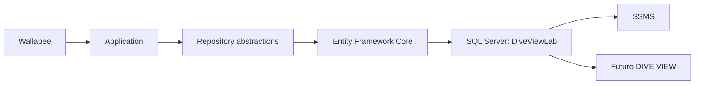

# Persistencia preparada para DIVE VIEW

DiveViewLab en Microsoft SQL Server es ahora la fuente central. WALLABEE escribe mediante EF Core y abstractions de repositorio; no depende de una API central intermedia para persistir. No se implementa la UI DIVE VIEW en esta tarea.

Consultar [DATABASE.md](DATABASE.md) para entidades, nombres físicos, relaciones, índices y configuración SSMS. Se reutilizan lab.Scans, lab.Experiments, lab.ExperimentRounds, lab.Samples, lab.ScanIndicators, benchmark.BenchmarkRuns, telemetry.SystemMetricSamples y telemetry.TelemetryEvents. Las versiones y hosts usan tablas de referencia.

DIVE VIEW puede consultar experiment overview, métricas de ronda, comparación de versiones, tasas de detección/evasión, precision/recall/F1, P95/P99, throughput, CPU/RAM, frecuencia de indicadores y falsos resultados. BenchmarkRuns guarda métricas como DECIMAL, ExperimentRounds mantiene la última ejecución de su ronda y Samples.GroundTruthLabel conserva etiquetas conocidas. Sin etiquetas, las métricas que no se pueden calcular son NULL, no tasas de éxito inventadas.

Las ocho vistas y los procedimientos existentes en reporting se conservan en la base revisada. En nuevas instalaciones, los scripts originales 05/06/07 pueden instalar las vistas/procedimientos/roles después de EF; no volver a crear las tablas. Los nombres físicos se conservan para compatibilidad. La comparación por versión usa FKs de WallabeeVersions y HoneyBadgerVersions.

La exportación HTTP anterior es opcional y está desactivada por defecto. Sus DTOs siguen en Wallabee.Contracts: ScanTelemetry, BenchmarkDto, RoundSummary y SystemMetricsDto. El endpoint remoto acordado sigue siendo POST /api/telemetry/events con TelemetryEnvelope(schemaVersion=1,eventId,eventType,data); ACK {eventId,accepted:true}. No se necesita ese receptor para consultar DiveViewLab.

Los archivos físicos viven en el laboratorio. SQL Server solo contiene metadata, resultados, relaciones y métricas. No se agregan blobs, raw bytes ni muestras Honey Badger.
