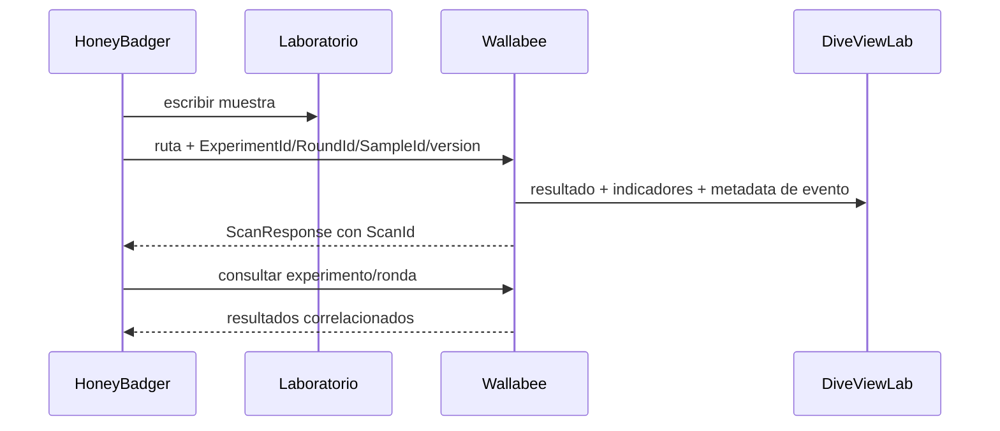

# Integracion Honey Badger

Los archivos permanecen en el laboratorio. Honey Badger genera muestras inertes, conserva sus IDs y envia la ruta de un archivo accesible por Wallabee; esta API no recibe uploads. Configurar Wallabee:LabRoot y mantener Quarantine:AutoQuarantine=false.

```http
POST /api/scan/file
Content-Type: application/json

{
  "filePath": "C:/lab/generated/sample_001.bin",
  "experimentId": "EXP-0001",
  "roundId": "ROUND-0004",
  "sampleId": "HB-00192",
  "honeyBadgerVersion": "0.2.0"
}
```

Ejemplo ilustrativo de respuesta; score, hash, tiempos e IDs dependen del archivo real:

```json
{
  "scanId": "36d5c7ae-4435-4916-9214-04cf07fb66f3",
  "fileName": "sample_001.bin",
  "sha256": "BA7816BF8F01CFEA414140DE5DAE2223B00361A396177A9CB410FF61F20015AD",
  "fileSize": 3,
  "riskScore": 0,
  "detectionLevel": "Clean",
  "startedAt": "2026-09-29T12:00:00Z",
  "completedAt": "2026-09-29T12:00:00.003Z",
  "durationMs": 3,
  "wallabeeVersion": "0.1.0",
  "experimentId": "EXP-0001",
  "roundId": "ROUND-0004",
  "sampleId": "HB-00192",
  "honeyBadgerVersion": "0.2.0",
  "indicators": [],
  "responseAction": "None",
  "retainSample": false,
  "retainReason": null
}
```

```http
GET /api/scans/experiment/EXP-0001/round/ROUND-0004?sampleId=HB-00192
GET /api/scans/experiment/EXP-0001?limit=100&offset=0
GET /api/scans/recent?limit=100&offset=0
GET /api/scans/36d5c7ae-4435-4916-9214-04cf07fb66f3
GET /api/scans/hash/BA7816BF8F01CFEA414140DE5DAE2223B00361A396177A9CB410FF61F20015AD
```

Consultas devuelven arrays salvo GET por ScanId. Limit se limita a 1-1000; Offset >=0. Hash se normaliza a mayusculas. Un scan nuevo recibe un ScanId nuevo, incluso si SampleId/Sha256 ya existen. Los consumidores deben evitar contar reanalisis como muestras unicas si su metrica usa SampleId.

`POST /api/scan/directory` acepta directoryPath mas los mismos campos de correlacion. Si se envia SampleId se aplica a todos los archivos; usar requests por archivo para SampleIds distintos. SQL Server rechaza reutilizar un SampleId del mismo experimento/ronda con hash o tamaño diferente. RetainSample=true requiere RetainReason valido. La retencion no copia el archivo.

Usar preferentemente rutas absolutas dentro del LabRoot configurado. Las rutas relativas se resuelven desde el working directory del proceso. El limite de tamano predeterminado es 100 MiB. Paths fuera del laboratorio y junctions/symlinks se rechazan.



Otros endpoints: GET /api/health; POST /api/benchmark/run; GET /api/benchmark/latest; GET /api/benchmark/{id}; POST/GET /api/quarantine; POST /api/quarantine/{id}/restore; DELETE /api/quarantine/{id}; GET /api/telemetry/status; POST /api/telemetry/retry. Cuarentena manual acepta {"filePath":"..."}. AllowRestore=false por defecto; Development lo habilita.

La conexión principal es SQL Server mediante ConnectionStrings:DiveViewDatabase. Los IDs públicos permanecen strings; las FKs internas son GUIDs. La respuesta HTTP no expone entidades EF.
