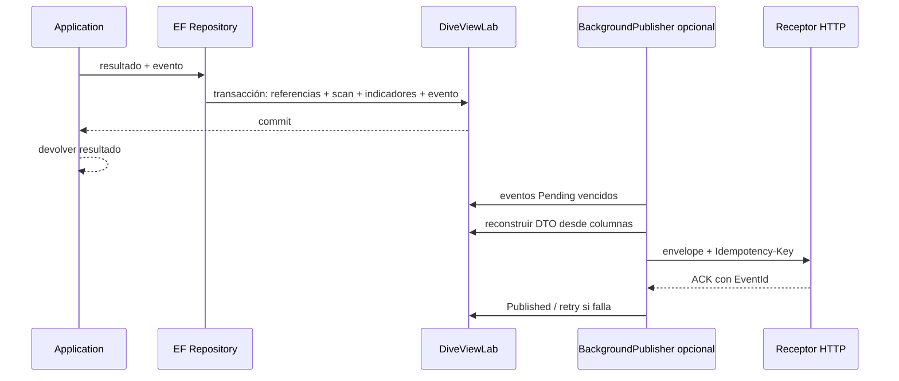

# Metadata de telemetría en SQL Server

SQL Server / DiveViewLab es ahora la persistencia principal. La publicación HTTP anterior sigue disponible como exportación opcional, con Telemetry.Enabled=false por defecto. No se necesita una Dive Telemetry API para guardar un scan ni consultar sus resultados desde SSMS.

telemetry.TelemetryEvents guarda EventId, SourceComponent, EventType, Severity, TimestampUtc, FKs de experimento/ronda/sample/scan/benchmark, Message, PayloadJson opcional y estado de exportación. PayloadJson está limitado a NVARCHAR(4000). Scans, benchmarks y rondas usan sus referencias para reconstruir el DTO al enviar; no duplican resultados completos en JSON. Los eventos de sistema llevan un pequeño DTO y también se guardan sus métricas como columnas. telemetry.TelemetryFailures conserva el tipo de error sanitizado, fecha e intento; no guarda response bodies ni excepciones completas.

GET /api/telemetry/status mantiene {pending,failed,published}; Pending puede acumularse con exportación desactivada y no implica que el resultado central esté sin guardar. POST /api/telemetry/retry reactiva pendientes/fallidos sin borrar historial. No se vuelve a marcar Published como Pending.

Con exportación habilitada: ACK debe tener accepted=true y el mismo EventId; backoff 2,5,15,30,60 segundos, máximo 8 intentos por defecto. Se usa el mismo EventId como Idempotency-Key, por lo que el receptor debe deduplicar. Entrega al menos una vez; una instancia exportadora por base compartida. No hay leasing distribuido entre varios exportadores. CancellationToken de apagado conserva pendientes sin consumir intento.

Los repositorios crean su DbContext con IDbContextFactory; BackgroundService no recibe un DbContext scoped. Sin conexión SQL no se pueden confirmar nuevos scans ni leer la cola: se eliminó la dependencia del almacenamiento SQLite offline. No hay purga automática; definir retención operacional de metadata e historial.

La conexión a SQL se configura con ConnectionStrings:DiveViewDatabase. Telemetry:BaseUrl solo configura el receptor HTTP opcional, nunca SQL. No se exportan rutas absolutas ni bytes de muestras.
